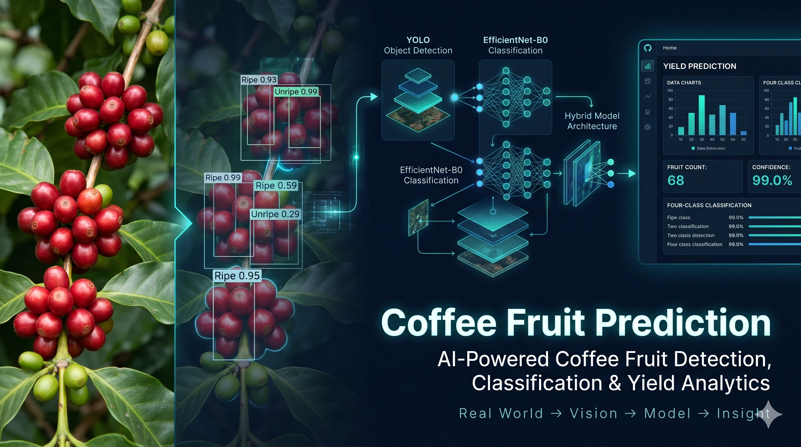
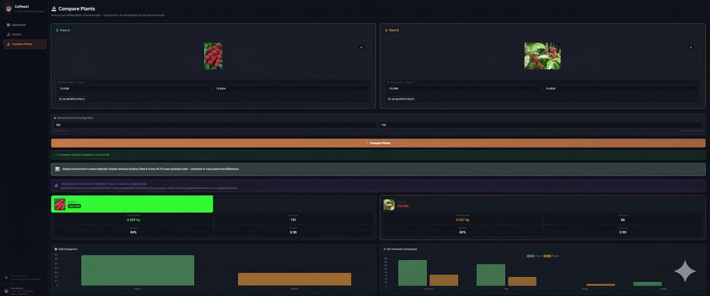
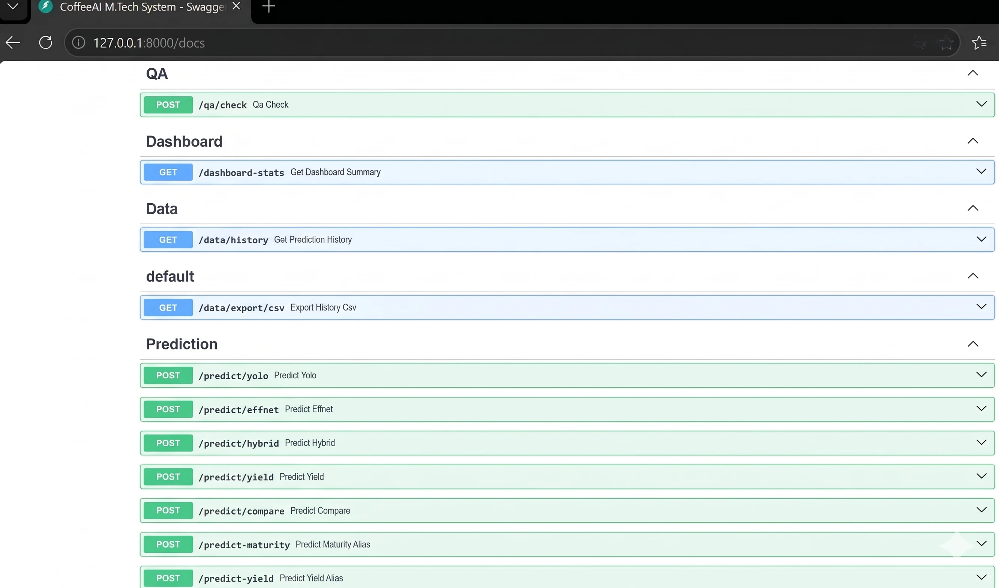
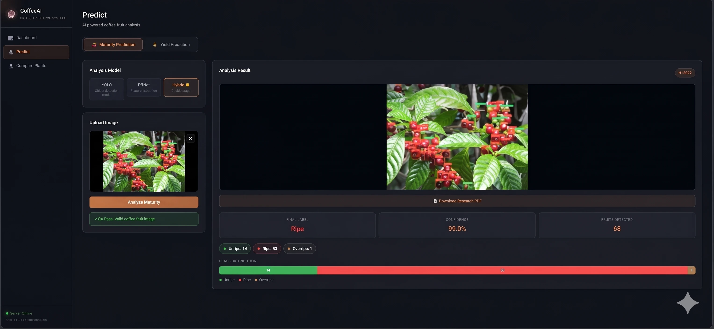
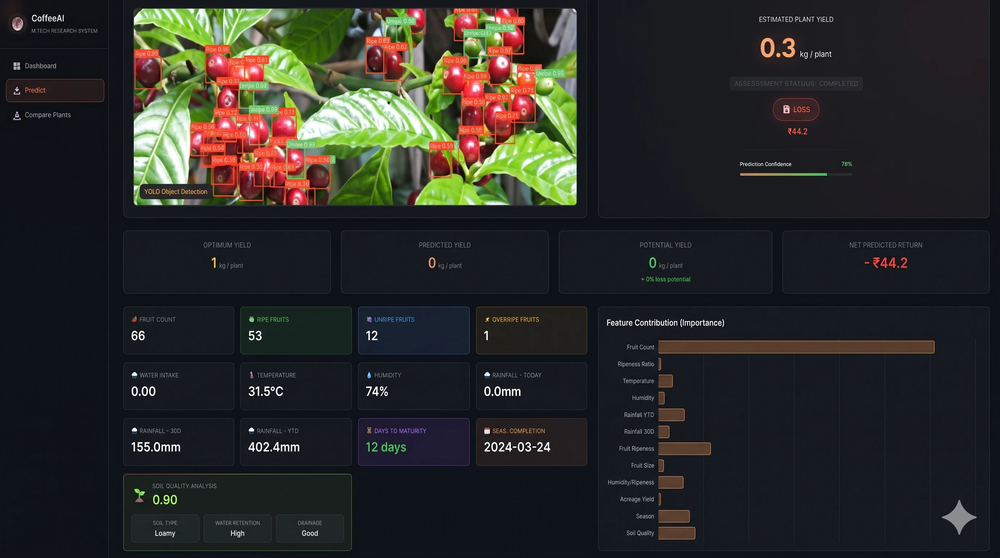
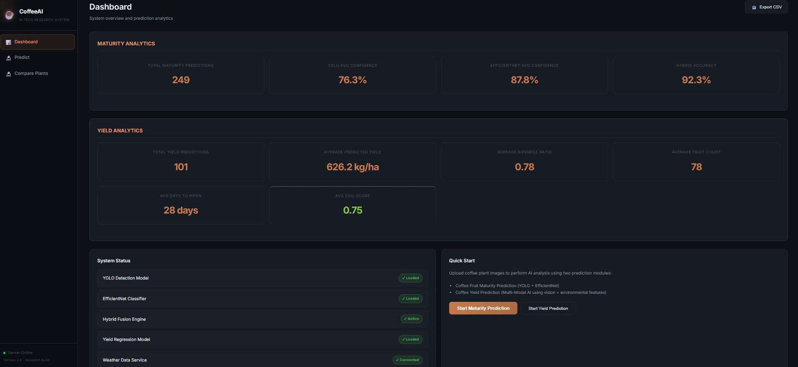

# CoffeeAI: Hybrid Deep Learning for Coffee Fruit Maturity Prediction



*AI-generated project banner. The application screenshots below show project visuals.*

## 🎓 Overview

CoffeeAI is a research-oriented coffee fruit maturity prediction system that combines **YOLOv11 object detection** and **EfficientNet-B0 image classification** through a configurable hybrid inference pipeline.

The system is designed to support coffee fruit maturity grading through image validation, model inference, confidence fusion, and prediction analytics.

### Key Features

- **Three prediction modes:** YOLO-only, EfficientNet-only, and Hybrid.
- **Image validation:** File type, size, and image-corruption checks.
- **QA gate:** Uses YOLO detections to determine whether an image can proceed through the pipeline.
- **Hybrid inference:** Combines detection-based and classification-based predictions using weighted fusion.
- **Prediction history:** Supports storing predictions that pass the QA stage.
- **Analytics interface:** Provides views for model metrics and prediction analysis.
- **Interactive frontend:** Includes prediction, analytics, and pipeline pages.

> **Project scope:** This repository presents a research prototype. Its performance, robustness, and deployment readiness should be established through reproducible evaluation and testing.

---

## 🧠 System Architecture

### Multi-Stage Pipeline

```text
Image Upload
     ↓
Input Validation
     ↓
YOLO-Based QA Gate
     ↓
Prediction Mode Selection
     ↓
Model Inference
     ↓
Hybrid Fusion (when selected)
     ↓
Prediction Result and Storage
```

### Stage 1: Input Validation

The pipeline is designed to support:

- JPG, PNG, and WEBP images.
- WEBP-to-PNG conversion.
- Image size validation with a configured limit of less than 10 MB.
- Corrupted-image detection.

### Stage 2: QA Gate

YOLO is used as an initial image-validation gate.

The documented criteria include:

- At least one detection with confidence ≥ 0.25.
- A valid detected bounding-box area ≥ 100 pixels².

Images that fail the QA gate should not proceed to the prediction stage or be stored as successful predictions.

*These thresholds are configurable and should be validated against representative coffee-fruit and non-coffee images.*

### Stage 3: Prediction Modes

#### 🟢 Mode A: YOLO Only

- Detects coffee fruits and predicts their classes.
- Uses majority voting across detected fruits.
- Calculates the final class confidence from the majority class detections.
- Provides bounding boxes and a final maturity label.

#### 🔵 Mode B: EfficientNet-B0 Only

- Classifies the uploaded image as a whole.
- Uses the model's softmax probabilities.
- Returns a class label and confidence.
- Does not provide object-level fruit detections.

#### 🟣 Mode C: Hybrid

The hybrid pipeline combines YOLO detections with EfficientNet-B0 classification.

1. YOLO detects fruits in the image.
2. Detected fruit regions are cropped.
3. EfficientNet-B0 classifies the extracted crops.
4. The corresponding model scores are combined using weighted fusion.
5. Fused predictions are used to determine the final maturity label.

**Fusion formula**

\[
P_{\text{fused}} =
\alpha P_{\text{EfficientNet}} +
(1-\alpha)P_{\text{YOLO}}
\]

Where:

- \(\alpha = 0.65\)
- EfficientNet-B0 weight: 0.65
- YOLO weight: 0.35

The formula describes the configured fusion approach. Its effectiveness depends on how the model scores are aligned, calibrated, and evaluated.

---

## 📊 Comparing the Prediction Modes

| Capability | YOLO Only | EfficientNet-B0 Only | Hybrid |
|---|---|---|---|
| Object detection | Yes | No | Yes |
| Whole-image classification | No | Yes | No |
| Crop-level classification | No | No | Yes |
| Uses both models | No | No | Yes |
| Weighted fusion | No | No | Yes |
| Object-level bounding boxes | Yes | No | Yes |

The hybrid mode combines detection and crop classification. Whether it improves accuracy, minority-class performance, or false-positive rates must be established through evaluation rather than assumed from the architecture alone.



---

## 🚀 Getting Started

### Prerequisites

- Python installed and available on your PATH.
- Git.
- The project dependencies listed in `requirements.txt`.
- Trained model weights at the paths expected by the application.

### 1. Clone the Repository

```bash
git clone https://github.com/SahanaK17/Coffee-prediction.git
cd Coffee-prediction
```

### 2. Create a Virtual Environment

**Windows**

```bash
python -m venv .venv
.venv\Scripts\activate
```

**macOS / Linux**

```bash
python3 -m venv .venv
source .venv/bin/activate
```

### 3. Install Dependencies

```bash
python -m pip install --upgrade pip
pip install -r requirements.txt
```

### 4. Verify Model Files

The application expects trained weights at the configured locations. The documented layout is:

```text
models/
├── yolo/
│   └── best.pt
└── effnet/
    └── effnet/
        └── best.pth
```

Check the actual model paths in the application configuration before starting the backend. Model weights may need to be obtained or trained separately.

### 5. Start the Backend

From the directory containing `main.py`:

```bash
python -m uvicorn main:app --reload --host 127.0.0.1 --port 8000
```

The backend should be available at:

`http://127.0.0.1:8000`

Use `--reload` for local development, not as a production server configuration.

### 6. Open the Frontend

You can open `frontend/index.html` in a browser, or serve the frontend locally:

```bash
cd frontend
python -m http.server 5500
```

Open:

`http://127.0.0.1:5500`

If the frontend cannot connect to the backend, check the API base URL in `frontend/index.js` and ensure it matches the backend address.

---

## 📡 API Endpoints

The documented API routes are listed below. Availability and request/response details should be confirmed against the current backend implementation.



### Health Check

| Method | Endpoint | Purpose |
|---|---|---|
| GET | `/health` | Check service status and model availability |

### Prediction

| Method | Endpoint | Mode |
|---|---|---|
| POST | `/predict/yolo` | YOLO-only inference |
| POST | `/predict/effnet` | EfficientNet-B0 inference |
| POST | `/predict/hybrid` | Hybrid inference |

**Request format:** Multipart form-data containing an image file, subject to the backend's actual request schema.

An illustrative response may contain fields such as:

```json
{
  "qa_pass": true,
  "qa_message": "QA Pass: Valid coffee fruit image",
  "mode": "Hybrid",
  "final_label": "Ripe",
  "final_confidence": 0.87,
  "fruits_detected": 12,
  "distribution": {
    "Unripe": 3,
    "Ripe": 7,
    "Overripe": 2
  },
  "annotated_image": "base64_encoded_image...",
  "fusion_alpha": 0.65
}
```

*The values above are illustrative examples, not measured results. The actual response schema and confidence interpretation depend on the backend implementation.*

### Analytics and History

| Method | Endpoint | Purpose |
|---|---|---|
| GET | `/analytics` | Retrieve analytics data |
| GET | `/data/history` | Retrieve stored prediction history |

The exact contents of analytics responses depend on the available training metrics and application data.

---

## 🔬 Frontend Features

### 1. Predict Page



The prediction interface is designed to provide:

- Selection between YOLO, EfficientNet-B0, and Hybrid modes.
- Image upload through drag-and-drop or file selection.
- QA feedback for images that fail validation.
- A final maturity label and confidence value.
- Fruit detection counts and class distributions when supported by the selected mode.
- An annotated image for download when provided by the backend.

### 2. Analytics Page



The analytics interface is intended to present:

- Training and validation curves.
- Confusion matrices.
- Model comparison information.
- Prediction-related analytics.

The presence of a chart does not by itself establish that its data are real evaluation results. Confirm whether each visualization uses trained-model metrics, actual prediction history, or placeholder data.

### 3. Pipeline Page

The pipeline page explains the system's processing stages, including:

- Input validation.
- The YOLO-based QA gate.
- The three prediction modes.
- The weighted-fusion formula.
- The research motivation behind the combined architecture.

---

## 📁 Project Structure

The documented project structure is shown below. Exact paths may vary with the current repository contents.

```text
Coffee-prediction/
├── main.py
├── requirements.txt
├── README.md
├── src/
│   ├── __init__.py
│   ├── inference.py
│   ├── train_yolo.py
│   ├── train_effnet.py
│   └── dataset_utils.py
├── frontend/
│   ├── index.html
│   ├── index.css
│   └── index.js
├── models/
│   ├── yolo/
│   │   └── best.pt
│   └── effnet/
│       └── effnet/
│           └── best.pth
├── data/
│   └── predictions_history.json
├── docs/
│   └── images/
└── Coffee Fruit Maturity ---.v1i.yolov8/
    ├── train/
    ├── valid/
    ├── test/
    └── data.yaml
```

*This is a documentation example, not a guarantee that every listed file or directory is present in every checkout.*

---

## 🎯 Research Highlights

### 1. QA-Gated Inference

**Motivation:** Image-classification models can produce predictions for images outside their intended domain.

**Approach:** Use YOLO detections as an initial gate before proceeding to the selected prediction mode.

**Evaluation needed:** Test the gate on both valid coffee-fruit images and representative irrelevant images. Measure false acceptance and false rejection rates.

### 2. Weighted Confidence Fusion

**Motivation:** Object detection and image classification provide different forms of evidence.

**Approach:** Combine the corresponding model scores using a configurable fusion weight.

**Evaluation needed:** Compare each individual model with the hybrid model on the same held-out dataset and investigate whether the resulting scores are calibrated.

### 3. Detection and Crop Classification

**Motivation:** A whole-image classifier and an object detector provide different information about an image.

**Approach:** Use YOLO to locate fruits and EfficientNet-B0 to classify extracted fruit crops in hybrid mode.

**Evaluation needed:** Measure per-class performance, especially for underrepresented maturity classes, and document the test methodology.

### 4. Environmental Data Context



The project includes an environmental-data visual. Any weather or soil-data integration should be documented with its actual data sources, API behavior, and role in prediction. Do not interpret environmental information as a model input unless the implemented pipeline uses it.

---

## 📈 Model Evaluation

The architecture is designed to combine object detection and image classification, but its actual performance must be measured.

No accuracy, precision, recall, or F1-score values are claimed here without verified evaluation evidence.

For a reproducible evaluation:

1. Define the dataset and maturity classes.
2. Separate training, validation, and test data appropriately.
3. Evaluate YOLO-only, EfficientNet-only, and Hybrid modes on comparable test examples.
4. Report accuracy, precision, recall, and F1-score, including per-class results where appropriate.
5. Include a confusion matrix and explain the averaging method used for classification metrics.
6. Document dataset size, class distribution, model configuration, and evaluation procedure.
7. Check whether confidence scores are calibrated before describing them as calibrated.

Add the measured results and supporting methodology here once the evaluation has been completed.

---

## 🛠️ Training the Models

The repository documentation lists the following training scripts. Review their configuration and dataset paths before executing them.

### Train YOLO

```bash
python src/train_yolo.py
```

### Prepare the EfficientNet Dataset

```bash
python src/dataset_utils.py
```

### Train EfficientNet-B0

```bash
python src/train_effnet.py
```

Training requires the expected datasets, dependencies, and configurations. Running a script does not guarantee that a valid model will be produced; verify the generated weights and evaluate them before using them for reported results.

---

## ⚙️ Configuration

The documented inference parameters include:

| Parameter | Documented value | Purpose |
|---|---:|---|
| `qa_min_confidence` | `0.25` | Minimum detection confidence for the QA gate |
| `qa_min_box_area` | `100` | Minimum bounding-box area in pixels² |
| `fusion_alpha` | `0.65` | EfficientNet-B0 weight in weighted fusion |

Check `src/inference.py` for the current parameter names, defaults, and validation logic.

---

## 🐛 Troubleshooting

### Backend Will Not Start

Install or verify the required dependencies:

```bash
pip install fastapi uvicorn python-multipart
```

Then start the backend from the directory containing `main.py`:

```bash
python -m uvicorn main:app --reload --host 127.0.0.1 --port 8000
```

Check the terminal output for missing packages, incorrect working directories, and configuration errors.

### Models Will Not Load

- Verify that the trained weights exist.
- Check the model paths configured in `main.py`.
- Confirm that the installed model libraries are compatible with the saved weights.
- Review the backend error message for the specific loading failure.

### QA Gate Always Fails

- Confirm that the image contains coffee fruits.
- Check the detector's class labels and confidence values.
- Verify that the configured confidence and bounding-box thresholds are appropriate.
- Evaluate the gate using representative valid and invalid images before changing thresholds.

### Analytics Charts Are Empty

- Confirm that the backend returns the data expected by the frontend.
- Check whether training metrics have actually been generated.
- Inspect browser developer tools for API errors.
- Verify whether a chart is configured to use real metrics or placeholder data.

---

## 📝 Citation

If you use this system in research, cite the repository with its actual author, publication year, and permanent URL.

A BibTeX template is provided below. Replace the placeholders with verified details before publication.

```bibtex
@software{coffeeai,
  title = {CoffeeAI: Hybrid Deep Learning for Coffee Fruit Maturity Prediction},
  author = {Sahana K},
  year = {2026},
  url = {https://github.com/SahanaK17/Coffee-prediction}
}
```

If a related paper or published research work directly informs this implementation, cite that publication separately with its verified bibliographic details.

---

## 📄 License

This project is intended for educational and research purposes.

Check the repository for an existing license file before distributing or reusing the code. If no license is present, clarify the intended reuse terms before treating the project as open source.

---

## 🙏 Acknowledgments

- **Ultralytics YOLO:** Object-detection framework.
- **EfficientNet:** Image-classification architecture introduced by Google Research.
- **Coffee fruit maturity dataset:** Roboflow dataset referenced in the project documentation.

Dataset attribution, license, and usage conditions should follow the original dataset's terms.

---

## 📞 Support

For questions, bugs, or suggestions, open an issue in the [Coffee-prediction GitHub repository](https://github.com/SahanaK17/Coffee-prediction).

## Project Status

**Research prototype — coffee fruit maturity prediction.**

The repository documents a multi-model inference pipeline and supporting frontend. Model performance, robustness, security, and production readiness require appropriate validation and testing before deployment.
